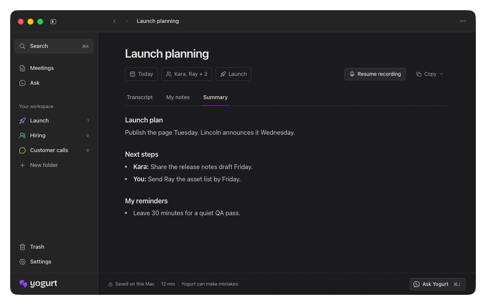

  

  Private AI meeting notes. A free, open-source alternative to Granola.

  Download for <a href="https://github.com/FrigadeHQ/yogurt/releases/latest/download/Yogurt-mac-arm64.dmg">Mac</a> · <a href="https://github.com/FrigadeHQ/yogurt/releases/latest/download/Yogurt-windows-x64.exe">Windows</a> · <a href="https://github.com/FrigadeHQ/yogurt/releases/latest/download/Yogurt-linux-x86_64.AppImage">Linux</a>

  Or on a Mac with <a href="https://brew.sh">Homebrew</a>: <code>brew install --cask frigadehq/yogurt/yogurt</code>

  

  Yogurt records your calls without adding a bot to the meeting.

  macOS 14.4+ (Apple Silicon) · Windows 10 2004+ (x64) · Ubuntu 22.04+ or similar (x64 AppImage) · 8 GB memory  
  <a href="https://yogurt.so?utm_source=github&utm_medium=readme&utm_campaign=yogurt">yogurt.so</a> · <a href="docs/README.md">Help</a> · <a href="docs/building.md">Build and run locally</a> · <a href="LICENSE">MIT license</a>  
  Made by <a href="https://frigade.com?utm_source=github&utm_medium=readme&utm_campaign=yogurt">Frigade</a>.

## What it does

- **Live transcripts.** Yogurt records calls and turns speech into text as you talk.
- **Meeting summaries.** Yogurt writes up the conversation and any notes you add.
- **Private by default.** Your audio, transcripts and AI processing stay on your computer.
- **Free and open source.** You can use Yogurt without an account.
- **Who said what.** Yogurt names speakers from Zoom, Teams and Meet on Mac, Windows and Linux.
- **Languages.** Multi-language mode transcribes 99 languages, follows each side of the call in its own language, and keeps up when someone switches languages mid-meeting.
- **Recording reminders.** Yogurt offers to record when a supported call starts.
- **Answers with sources.** Yogurt answers questions across meetings and links to the source.
- **Folders and search.** You can find meetings by folder, title, notes or transcript.
- **Copy and export.** You can copy notes or transcripts, or save both as Markdown.
- **Local MCP server.** When you turn this on, apps on your computer can read your notes, transcripts, saved audio and each meeting's calendar details (attendees' names and emails).
- **Automatic stop.** By default, Yogurt stops recording when it detects that your call has ended.

## Watch the demo

https://github.com/user-attachments/assets/da16b894-beb1-491a-89e1-fd10666dc9b8

## How it works

1. **Record.** Start recording your microphone and call audio; you can add your own notes.
2. **Transcribe.** Yogurt uses whisper.cpp and, on supported Macs, Apple SpeechAnalyzer.
3. **Summarize and ask.** A local open-weight model runs through llama.cpp.

Meeting data stays local; Yogurt goes online for model downloads and update checks.

Where your meetings, recordings, settings and models are stored

- Mac uses `~/Library/Application Support/Yogurt`.
- Windows uses `%APPDATA%\Yogurt`.
- Linux uses `~/.config/Yogurt`, or `$XDG_CONFIG_HOME/Yogurt` if set.

## FAQ

<strong>What kind of computer do I need?</strong>

 

> A Mac with Apple silicon and macOS 14.4 or newer, a 64-bit PC with Windows 10 (version 2004) or newer, or a 64-bit Linux computer with Ubuntu 22.04 or newer. Each needs at least 8 GB of memory. If your computer is too slow, Yogurt tells you during setup. On Windows and Linux, you connect your calendar with a private calendar link.

<strong>Does Yogurt join my meetings?</strong>

 

> No. Yogurt records your microphone and the sound playing on your computer. No bot joins the call, so let the other people on the call know you’re recording.

<strong>Are recordings saved?</strong>

 

> Audio is saved by default, and you can turn this off for future meetings in Settings.

<strong>Is Yogurt free?</strong>

 

> Yes. Yogurt is free and open source under the MIT license. No account is needed.

<strong>Does Yogurt work offline?</strong>

 

> Yes. After a one-time download of the AI models, transcription and summaries run locally on your computer.

<strong>How much does setup download?</strong>

 

> It depends on your computer. Yogurt sets up transcription first, then downloads the notes models selected for your computer. Recording works once setup finishes, and notes and questions work offline once the notes model is in.

<strong>How do I connect my assistant app?</strong>

 

> In **Settings → AI apps**, turn on access, copy the helper command, and add it as a local MCP server in your assistant app. Access is off by default. The app can read your meetings (including their calendar details: the event, and attendees' names and emails), notes and transcripts, but cannot change them. It may send what it reads to its own online model. Turn access off in Yogurt to stop further reads.

<strong>Can other apps read my notes through MCP?</strong>

 

> Access is off until you enable it in **Settings → AI apps**. Apps get read-only access to meetings (with their calendar event and attendees' names and emails), notes and transcripts. Mac and Linux use a socket in your profile folder with `0600` permissions, so only your user account can open it. Windows uses a named pipe with a new random name each launch, stored only in your profile folder. There is no per-app token, so any app running under your account can read while access is on. Settings shows connected apps by their self-reported names.

<strong>Which AI models does Yogurt use?</strong>

 

> Transcription uses Whisper through whisper.cpp, with large-v3-turbo or a smaller model depending on your computer. On supported Macs, Apple SpeechAnalyzer supplies live words while Whisper produces the saved transcript. Summaries and answers use a local open-weight model from the Gemma 4, gpt-oss or Qwen3 families, chosen for your hardware and run through llama.cpp. The app uses Electron and needs no account.

<strong>Which languages does Yogurt support?</strong>

 

> Pick **Multi-language** in **Settings → Language → Spoken language** to transcribe 99 languages. You can also switch from the **English** menu in a note’s footer before or during recording. English only is the default, and it’s the fastest and most accurate choice for English meetings.
>
> In Multi-language mode, you and the other side of the call can each speak your own language, and Yogurt follows along when someone switches languages mid-meeting. Summaries follow the meeting’s main language, or the one you pick in **Settings → Summary language**. Answers in Ask follow your question’s language. Settings also offers 32 app languages.

<strong>Which call apps does Yogurt work with?</strong>

 

> You can record calls in any app because Yogurt captures your microphone and system audio. Call detection covers Zoom, Teams and Meet. On Mac, Yogurt can also read their speaker names with Accessibility permission, when the call app shows who is speaking.

<strong>How does Yogurt know a call has started?</strong>

 

> It checks which apps are using your microphone. For browser calls, it also checks the tab title or a nearby calendar event with a call link. This triggers an offer to record; recording starts only when you choose to.

<strong>How do I connect my calendar?</strong>

 

> On Mac, allow Calendar access in Settings. Yogurt reads the calendars already on your computer and lets you choose which ones to show. You do not sign into a calendar account in Yogurt.

## Build from source

See [Build and run locally](docs/building.md) for setup, tests and installer builds.

## License

[MIT](LICENSE) · Copyright 2026 Frigade.
