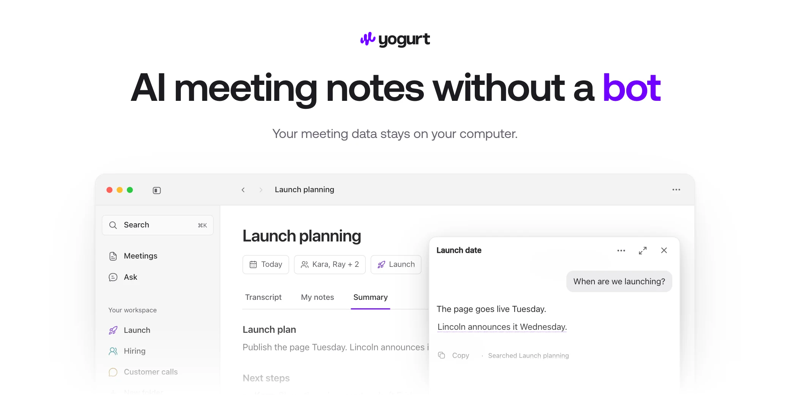

<p align="center"><a href="https://yogurt.so?utm_source=github&utm_medium=readme&utm_campaign=yogurt"><picture><source media="(prefers-color-scheme: dark)" srcset="docs/assets/readme-banner-app-dark.webp"></picture></a></p>

<div align="center"><strong>Yogurt</strong></div>
<div align="center">Ghi chú cuộc họp bằng AI riêng tư, không có bot trong cuộc gọi của bạn.<br />Một lựa chọn thay thế miễn phí, mã nguồn mở cho Granola, Otter và Fireflies.</div>
<br />
<div align="center">
<a href="https://yogurt.so?utm_source=github&utm_medium=readme&utm_campaign=yogurt">Trang web</a>
<span> · </span>
<a href="https://github.com/FrigadeHQ/yogurt">GitHub</a>
</div>
<div align="center">
<a href="README.md">English</a>
<span> · </span>
<strong>Tiếng Việt</strong>
</div>

## Giới thiệu

Yogurt ghi lại micro và âm thanh cuộc gọi của bạn, rồi chép lời và tóm tắt ngay trên máy Mac, Windows hoặc Linux của bạn. Nó nhận diện người nói từ Zoom, Teams và Meet, đồng thời trả lời câu hỏi xuyên suốt các cuộc họp kèm nguồn trích dẫn.

## Vì sao

Cuộc trò chuyện của chúng ta nên là chuyện riêng của chúng ta. Ghi chú tốt không nên cần đến máy chủ của bên thứ ba hay một tài khoản. Đó là lý do chúng tôi xây dựng Yogurt để ghi âm, chép lời và tóm tắt ngay trên máy tính của bạn. Nó chỉ kết nối mạng để tải mô hình và kiểm tra bản cập nhật.

## Tải xuống

Yogurt miễn phí cho [Mac](https://github.com/FrigadeHQ/yogurt/releases/latest/download/Yogurt-mac-arm64.dmg), [Windows](https://github.com/FrigadeHQ/yogurt/releases/latest/download/Yogurt-windows-x64-setup.exe) và [Linux](https://github.com/FrigadeHQ/yogurt/releases/latest/download/Yogurt-linux-x86_64-setup.AppImage).

Trên Mac, bạn cũng có thể dùng [Homebrew](https://brew.sh).

```sh
brew install --cask frigadehq/yogurt/yogurt
```

## Yogurt làm được gì

- **Chép lời trực tiếp.** Yogurt ghi lại cuộc gọi và chuyển lời nói thành văn bản ngay khi bạn nói.
- **Tóm tắt cuộc họp.** Yogurt viết lại nội dung cuộc trò chuyện cùng mọi ghi chú bạn thêm vào.
- **Riêng tư theo mặc định.** Âm thanh, bản chép lời và quá trình xử lý AI của bạn đều ở lại trên máy tính của bạn.
- **Miễn phí và mã nguồn mở.** Bạn có thể dùng Yogurt mà không cần tài khoản.
- **Ai nói gì.** Yogurt nhận diện người nói từ Zoom, Teams và Meet trên Mac, Windows và Linux.
- **Ngôn ngữ.** Chế độ Đa ngôn ngữ chép lời 99 ngôn ngữ, theo dõi từng phía của cuộc gọi bằng ngôn ngữ của chính họ và bắt kịp khi ai đó đổi ngôn ngữ giữa cuộc họp.
- **Nhắc ghi âm.** Yogurt đề xuất ghi âm khi một cuộc gọi được hỗ trợ bắt đầu.
- **Trả lời kèm nguồn.** Yogurt trả lời câu hỏi xuyên suốt các cuộc họp và liên kết tới nguồn.
- **Thư mục và tìm kiếm.** Bạn có thể tìm cuộc họp theo thư mục, tiêu đề, ghi chú hoặc bản chép lời.
- **Sao chép và xuất.** Bạn có thể sao chép ghi chú hoặc bản chép lời, hoặc lưu cả hai dưới dạng Markdown.
- **Máy chủ MCP cục bộ.** Khi bạn bật tính năng này, các ứng dụng trên máy tính của bạn có thể đọc ghi chú, bản chép lời, âm thanh đã lưu và chi tiết lịch của từng cuộc họp (tên và email của người tham dự).
- **Tự động dừng.** Theo mặc định, Yogurt dừng ghi âm khi phát hiện cuộc gọi của bạn đã kết thúc. Còn bản ghi bạn tự bắt đầu bằng Ghi chú mới sẽ hỏi trước thay vào đó, vì đó có thể không phải là một cuộc gọi.

## Xem bản demo

https://github.com/user-attachments/assets/da16b894-beb1-491a-89e1-fd10666dc9b8

## Cách hoạt động

1. **Ghi âm.** Bắt đầu ghi lại micro và âm thanh cuộc gọi của bạn; bạn có thể thêm ghi chú của riêng mình.
2. **Chép lời.** Yogurt dùng whisper.cpp và, trên các máy Mac được hỗ trợ, Apple SpeechAnalyzer.
3. **Tóm tắt và hỏi.** Một mô hình trọng số mở chạy cục bộ thông qua llama.cpp.

Dữ liệu cuộc họp ở lại trên máy của bạn; Yogurt chỉ kết nối mạng để tải mô hình và kiểm tra bản cập nhật.

<details><summary>Nơi lưu trữ cuộc họp, bản ghi, cài đặt và mô hình của bạn</summary>

- Mac dùng `~/Library/Application Support/Yogurt`.
- Windows dùng `%APPDATA%\Yogurt`.
- Linux dùng `~/.config/Yogurt`, hoặc `$XDG_CONFIG_HOME/Yogurt` nếu đã đặt.

</details>

## Câu hỏi thường gặp

<details><summary><strong>Tôi cần loại máy tính nào?</strong></summary>

<br>

> Một máy Mac dùng Apple silicon với macOS 14.4 trở lên, một PC 64-bit với Windows 10 (phiên bản 2004) trở lên, hoặc một máy Linux 64-bit với Ubuntu 22.04 trở lên. Mỗi máy cần ít nhất 8 GB bộ nhớ. Nếu máy tính của bạn quá chậm, Yogurt sẽ cho bạn biết trong lúc cài đặt. Trên Windows và Linux, bạn kết nối lịch bằng một liên kết lịch riêng tư.

</details>

<details><summary><strong>Yogurt có tham gia cuộc họp của tôi không?</strong></summary>

<br>

> Không. Yogurt ghi lại micro của bạn và âm thanh đang phát trên máy tính của bạn. Không có bot nào tham gia cuộc gọi, vì vậy hãy cho những người khác trong cuộc gọi biết rằng bạn đang ghi âm.

</details>

<details><summary><strong>Bản ghi có được lưu lại không?</strong></summary>

<br>

> Âm thanh được lưu theo mặc định, và bạn có thể tắt việc này cho các cuộc họp sau trong Cài đặt.

</details>

<details><summary><strong>Yogurt có miễn phí không?</strong></summary>

<br>

> Có. Yogurt miễn phí và mã nguồn mở theo giấy phép MIT. Không cần tài khoản.

</details>

<details><summary><strong>Yogurt có hoạt động ngoại tuyến không?</strong></summary>

<br>

> Có. Sau một lần tải xuống các mô hình AI, việc chép lời và tóm tắt chạy cục bộ trên máy tính của bạn.

</details>

<details><summary><strong>Yogurt có huấn luyện AI bằng cuộc họp của tôi không? Có ai ở Yogurt đọc được chúng không?</strong></summary>

<br>

> Không. Bản ghi, bản chép lời và ghi chú của bạn ở lại trên máy tính của bạn, và Yogurt không có máy chủ nào tiếp nhận chúng, nên không ai ở Yogurt có thể đọc chúng. Các mô hình AI chạy trên máy tính của bạn và không học từ cuộc họp của bạn. Yogurt chỉ kết nối mạng để tải mô hình, kiểm tra bản cập nhật và, nếu bạn thêm vào, đọc liên kết lịch của bạn.

</details>

<details><summary><strong>Yogurt có an toàn cho các cuộc họp bảo mật không?</strong></summary>

<br>

> Yogurt giữ mọi thứ trên máy tính của bạn: âm thanh, bản chép lời và ghi chú không bao giờ được tải lên, còn việc chép lời và tóm tắt chạy ngoại tuyến. Nhờ vậy, nó phù hợp với các cuộc gọi với khách hàng, buổi trị liệu, công việc pháp lý và họp hội đồng, nơi âm thanh không thể đưa lên dịch vụ đám mây. Bạn cũng có thể tắt lưu âm thanh trong **Cài đặt**, và Yogurt là mã nguồn mở nên ai cũng có thể kiểm tra nó làm gì. Hãy tuân theo quy định của riêng bạn về việc xin đồng ý trước khi ghi âm.

</details>

<details><summary><strong>Tôi cần bao nhiêu bộ nhớ?</strong></summary>

<br>

> Ít nhất 8 GB. Yogurt kiểm tra máy tính của bạn trong lúc cài đặt và chọn các mô hình chép lời và ghi chú tốt nhất mà máy có thể chạy tốt. Với 16 GB trở lên, Yogurt thường có thể chạy một mô hình ghi chú lớn hơn, cho ra ghi chú tốt hơn.

</details>

<details><summary><strong>Tôi có thể biến một bản ghi sẵn có thành ghi chú không?</strong></summary>

<br>

> Có. Dùng **Tải tệp lên** để thêm một bản ghi MP3, M4A hoặc WAV. Yogurt chép lời nó trên máy tính của bạn và viết ghi chú, giống như với một cuộc họp trực tiếp.

</details>

<details><summary><strong>Tôi có thể đặt câu hỏi trên tất cả các cuộc họp của mình không?</strong></summary>

<br>

> Có. Dùng **Hỏi** để hỏi về một cuộc họp, một thư mục, hoặc tất cả các cuộc họp của bạn cùng lúc, ví dụ "chúng ta đã quyết định gì về giá?". Các câu trả lời chỉ tới cuộc họp mà chúng xuất phát từ đó, và mọi thứ chạy trên máy tính của bạn.

</details>

<details><summary><strong>Độ chính xác so với chép lời trên đám mây thì sao?</strong></summary>

<br>

> Yogurt dùng Whisper large-v3-turbo trên các máy tính chạy được nó — cùng họ mô hình mà nhiều dịch vụ đám mây sử dụng — nên độ chính xác với tiếng Anh gần ngang chép lời trên đám mây. Các máy nhỏ hơn dùng mô hình Whisper nhỏ hơn, nhanh hơn nhưng mắc nhiều lỗi hơn, nhất là với các ngôn ngữ ngoài tiếng Anh. Bạn có thể thêm tên và từ vào từ vựng tùy chỉnh để chúng được viết đúng chính tả.

</details>

<details><summary><strong>Quá trình cài đặt tải xuống bao nhiêu?</strong></summary>

<br>

> Tùy thuộc vào máy tính của bạn. Yogurt cài đặt phần chép lời trước, rồi tải các mô hình ghi chú được chọn cho máy của bạn. Việc ghi âm hoạt động ngay khi cài đặt hoàn tất, và ghi chú cùng câu hỏi hoạt động ngoại tuyến khi mô hình ghi chú đã sẵn sàng.

</details>

<details><summary><strong>Làm sao để kết nối ứng dụng trợ lý của tôi?</strong></summary>

<br>

> Trong **Cài đặt → Ứng dụng AI**, bật quyền truy cập, sao chép lệnh hỗ trợ và thêm nó làm máy chủ MCP cục bộ trong ứng dụng trợ lý của bạn. Quyền truy cập tắt theo mặc định. Ứng dụng có thể đọc cuộc họp của bạn (bao gồm chi tiết lịch của chúng: sự kiện, tên và email của người tham dự), ghi chú và bản chép lời, nhưng không thể thay đổi chúng. Nó có thể gửi những gì đọc được tới mô hình trực tuyến của chính nó. Tắt quyền truy cập trong Yogurt để ngăn việc đọc thêm.

</details>

<details><summary><strong>Các ứng dụng khác có thể đọc ghi chú của tôi qua MCP không?</strong></summary>

<br>

> Quyền truy cập tắt cho đến khi bạn bật nó trong **Cài đặt → Ứng dụng AI**. Các ứng dụng được quyền chỉ đọc đối với cuộc họp (kèm sự kiện lịch và tên, email của người tham dự), ghi chú và bản chép lời. Mac và Linux dùng một socket trong thư mục hồ sơ của bạn với quyền `0600`, nên chỉ tài khoản người dùng của bạn mới mở được. Windows dùng một named pipe với tên ngẫu nhiên mới mỗi lần khởi chạy, chỉ lưu trong thư mục hồ sơ của bạn. Không có token riêng cho từng ứng dụng, nên bất kỳ ứng dụng nào chạy dưới tài khoản của bạn cũng có thể đọc khi quyền truy cập đang bật. Cài đặt hiển thị các ứng dụng đã kết nối theo tên mà chúng tự khai báo.

</details>

<details><summary><strong>Yogurt dùng những mô hình AI nào?</strong></summary>

<br>

> Việc chép lời dùng Whisper thông qua whisper.cpp, với large-v3-turbo hoặc một mô hình nhỏ hơn tùy máy tính của bạn. Trên các máy Mac được hỗ trợ, Apple SpeechAnalyzer cung cấp từ ngữ trực tiếp trong khi Whisper tạo bản chép lời được lưu lại. Tóm tắt và câu trả lời dùng một mô hình trọng số mở chạy cục bộ thuộc các họ Gemma 4, gpt-oss hoặc Qwen3, được chọn theo phần cứng của bạn và chạy qua llama.cpp. Ứng dụng dùng Electron và không cần tài khoản.

</details>

<details><summary><strong>Yogurt hỗ trợ những ngôn ngữ nào?</strong></summary>

<br>

> Chọn **Đa ngôn ngữ** trong **Cài đặt → Ngôn ngữ → Ngôn ngữ nói** để chép lời 99 ngôn ngữ. Bạn cũng có thể chuyển đổi từ menu **Tiếng Anh** ở chân trang của ghi chú trước hoặc trong khi ghi âm. Chỉ tiếng Anh là mặc định, và đó là lựa chọn nhanh nhất, chính xác nhất cho các cuộc họp bằng tiếng Anh.
>
> Ở chế độ Đa ngôn ngữ, bạn và phía bên kia cuộc gọi có thể mỗi người nói ngôn ngữ của mình, và Yogurt theo kịp khi ai đó đổi ngôn ngữ giữa cuộc họp. Tóm tắt theo ngôn ngữ chính của cuộc họp, hoặc ngôn ngữ bạn chọn trong **Cài đặt → Ngôn ngữ tóm tắt**. Câu trả lời trong mục Hỏi theo ngôn ngữ của câu hỏi của bạn. Cài đặt cũng cung cấp 32 ngôn ngữ ứng dụng.

</details>

<details><summary><strong>Yogurt hoạt động với những ứng dụng gọi điện nào?</strong></summary>

<br>

> Bạn có thể ghi lại cuộc gọi trong bất kỳ ứng dụng nào vì Yogurt thu micro và âm thanh hệ thống của bạn. Tính năng phát hiện cuộc gọi bao phủ Zoom, Teams và Meet. Trên Mac, Yogurt còn có thể đọc tên người nói của chúng với quyền Accessibility, khi ứng dụng gọi điện hiển thị ai đang nói.

</details>

<details><summary><strong>Làm sao Yogurt biết một cuộc gọi đã bắt đầu?</strong></summary>

<br>

> Nó kiểm tra những ứng dụng nào đang dùng micro của bạn. Với các cuộc gọi trên trình duyệt, nó còn kiểm tra tiêu đề tab hoặc một sự kiện lịch gần đó có liên kết cuộc gọi. Điều này kích hoạt một đề xuất ghi âm; việc ghi âm chỉ bắt đầu khi bạn chọn.

</details>

<details><summary><strong>Làm sao để kết nối lịch của tôi?</strong></summary>

<br>

> Trên Mac, cho phép quyền truy cập Lịch trong Cài đặt. Yogurt đọc các lịch đã có sẵn trên máy tính của bạn và cho bạn chọn lịch nào sẽ hiển thị. Bạn không đăng nhập vào tài khoản lịch nào trong Yogurt.

</details>

## Hỗ trợ

- [Trợ giúp](docs/README.md)
- [Discord](https://yogurt.so/discord)
- [Báo lỗi](https://github.com/FrigadeHQ/yogurt/issues)

## Phát triển

- [Build và chạy cục bộ](docs/building.md)

---

Được tạo bởi [Frigade](https://frigade.com?utm_source=github&utm_medium=readme&utm_campaign=yogurt), [giấy phép MIT](LICENSE).
